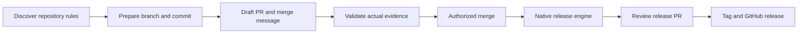

# Git FlowKit

**AI Git workflows, Conventional Commits, and safe semantic releases. Your rules.**

[English](README.md) · [ภาษาไทย](README.th.md) · [Configuration](skills/git-flowkit/references/configuration.md) · [Release setup](skills/git-flowkit/references/releases.md)

One portable Agent Skill for branch naming, commits, pull requests, merge messages,
and release planning. Reuse your existing repository policies instead of replacing
them with another agent's defaults.

> **Initial implementation — not a published stable release.** The offline helpers
> are executable and tested. Remote release automation is opt-in. Cross-agent
> end-to-end compatibility is not yet certified; see [compatibility](skills/git-flowkit/references/compatibility.md).

[Install by agent or integrate an API client](skills/git-flowkit/references/compatibility.md#project-installation-by-host)

## Install the skill

```bash
npx skills add whale-devx/git-flowkit-skills --skill git-flowkit
```

Choose your coding agent in the installer. Add `-g` for a user-global installation.
The installer is the external [Skills CLI](https://github.com/vercel-labs/skills), not
an npm package published by this project. Check its current Node.js requirements.
For a manual installation, copy the complete `skills/git-flowkit` directory into your
agent's documented skills directory; do not copy `SKILL.md` alone.

Ask your agent:

> Use git-flowkit to inspect this repository, follow its existing rules, and prepare
> a branch, Conventional Commit, PR description, and release preview. Do not publish.

## What is implemented

| Capability | Included in this implementation |
| --- | --- |
| Repository discovery | Local policy, native PR/MR templates, supported release-engine signals, conflicts |
| Branch and commits | Configurable naming pattern, ticket IDs, Conventional Commit validation, breaking markers |
| Templates | Editable commit, PR, merge, and release templates; local/global resolution; strict placeholder validation |
| Safe setup | Preview by default; explicit local apply; no overwrites; idempotent initialization |
| Version planning | Single-package SemVer preview, custom bump rules, pre-1.0 policy, initial prerelease creation |
| Release automation | Review-gated Release Please scaffold; this repository's automation waits for all CI jobs |
| Merge readiness | Offline evidence checks for HEAD, freshness, approvals, checks, protection, and review threads |
| Portability | Agent Skills format; Python 3.11+ and Git; standard library only; no provider API dependency |

**Not claimed:** autonomous merges, built-in registry publishing, universal native-config
parsing, monorepo dependency propagation, or end-to-end testing in every coding agent.
Existing semantic-release, Changesets, Python Semantic Release, release-plz, GoReleaser,
and JReleaser configurations are detected and retained, not reimplemented.

## Try the helpers

From a clone of this repository, with Python 3.11+ and Git:

```bash
python skills/git-flowkit/scripts/flowkit.py doctor
python skills/git-flowkit/scripts/flowkit.py branch feat "Add team templates" --ticket DEV-42
python skills/git-flowkit/scripts/flowkit.py check-commit --message "feat(templates): add team templates"
python skills/git-flowkit/scripts/flowkit.py render pr --data examples/pr-data.json --template skills/git-flowkit/assets/templates/pr.md
python skills/git-flowkit/scripts/flowkit.py release-preview --current 1.4.2 --commits examples/commits.json
```

The examples produce `feat/DEV-42-add-team-templates` and an advisory next version of
`1.5.0`. No branch or release is created. Example PR validation is explicitly **not run**.

For another repository, put `--repo /path/to/repository` **before** the command and
invoke the script from its actual installation path.

```text
python <installed-skill>/scripts/flowkit.py --repo <your-repo> init
python <installed-skill>/scripts/flowkit.py --repo <your-repo> init --apply
```

`init` creates only missing files. Edit `.git-flowkit.json` to select the generated
`.git-flowkit/templates/*.md` files. Native repository templates keep precedence until
you explicitly select another template. `init --global --apply` sets up personal defaults.

## Configuration is yours

```json
{
  "version": 1,
  "branch": { "pattern": "{type}/{ticket}{slug}" },
  "commit": { "require_scope": true, "max_subject_length": 72 },
  "templates": { "pr": ".git-flowkit/templates/pr.md" },
  "release": { "engine": "auto", "pre1_breaking": "minor" }
}
```

JSON is the implemented configuration format; the earlier proposed YAML interface is
not a shipped parser. Native engine configuration retains its original format.
[Full configuration reference](skills/git-flowkit/references/configuration.md) explains
precedence, validation, global paths, supported fields, and migration boundaries.

## From change to release



The agent prepares and checks. Repository protections and the native release engine
remain authoritative. For this repository, CI can create Release Please PRs and releases
only after a maintainer explicitly sets `FLOWKIT_RELEASE_ENABLED=true`.
It does not publish to npm or PyPI. See the [activation checklist](skills/git-flowkit/references/releases.md).

## Safety and verification

The CLI never commits, pushes, merges, tags, fetches, installs packages, or publishes.
Only `init --apply` and `release-setup --apply` write missing local files. Templates are
inert text; config cannot inject executable template expressions. Read the
[security policy](SECURITY.md) and [evidence contract](skills/git-flowkit/references/safety.md).

```bash
python -m unittest discover -s tests -v
python tools/validate_repo.py
```

CI is configured for Linux, macOS, and Windows on Python 3.11 and 3.13. A configured
matrix is not a claim that every run has passed; inspect the PR's actual checks.

## Contribute

Start with [CONTRIBUTING.md](CONTRIBUTING.md). High-value contributions include reproducible
agent compatibility tests, translations, native-engine fixtures, and safety regressions.
[ROADMAP.md](ROADMAP.md) distinguishes shipped behavior from planned work.

Built around [Agent Skills](https://agentskills.io/specification),
[Conventional Commits 1.0.0](https://www.conventionalcommits.org/en/v1.0.0/),
and [Semantic Versioning 2.0.0](https://semver.org/).
See [sources](skills/git-flowkit/references/sources.md) for the upstream specifications.

MIT licensed. Existing license attribution is preserved.

From a Git checkout, reproduce the project-local install and helper journey with
`python tools/install_smoke.py candidate`. Use `python tools/install_smoke.py main`
for the public source. Both need npm registry access, Node.js with npx, Python and Git.
The main check also needs GitHub access and the main commit in the checkout.
Each run creates a disposable project and prints the revision and installed path.
When a Windows log uses a legacy encoding, characters it cannot represent appear as Unicode escapes.
If the installer fails, inspect its output and rerun after connectivity returns.
